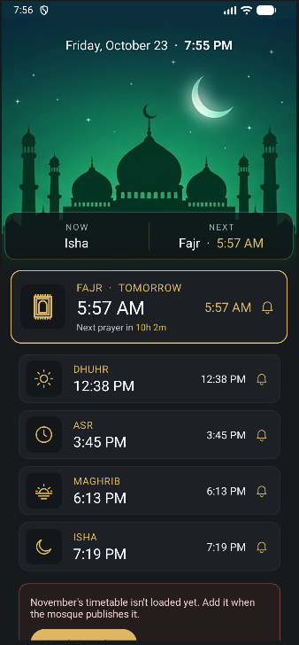

# Prayer Alerts

An Android app that sends a notification at the start of each daily prayer, using **your mosque's own monthly timetable**. Take a photo or screenshot of the timetable (or grab the PDF), and the app reads the times on the device and schedules the alerts.

<p align="center">
  
</p>

Most prayer apps calculate times from your location. Many mosques publish their own timetable, which can differ by a few minutes. Prayer Alerts uses the mosque's published times as they are.

---

## Features

- **Alerts at prayer start:** Fajr, Dhuhr (shown as Jumu'ah on Fridays), Asr, Maghrib and Isha.
- **Monthly timetable from an image or PDF.** Text recognition runs on the phone (Google ML Kit, bundled), so it works offline.
- **Review grid before saving.** Suspicious cells are highlighted in red (empty, out of order, or far from neighbouring days). You can compare against the original image and fix anything.
- **Per-prayer alert toggle.** Tap the bell on any prayer card to mute or unmute it.
- **Choose any sound on your phone:** a notification sound, alarm sound or ringtone, one per prayer or one for all.
- **Main screen:**
  - A mosque header with today's date and time.
  - A **Now / Next** panel.
  - A gold-highlighted card for the next prayer with a countdown.
  - The rest of the day's prayers below.
- **Three home-screen widgets.** See [Widgets](#widgets).
- **Reminder to load next month.** When it's due, the main button changes to *Load November timetable* (for example).
- **Alarms come back after a reboot, app update, or time and time-zone change.** Daylight-saving changes are handled automatically.
- **Adaptive app icon** with an Android 13+ themed (monochrome) variant.

## Widgets

Long-press your home screen, tap **Widgets**, find **Prayer Alerts**, and drag one out.

| Widget | Size | Shows |
|---|---|---|
| **Prayer countdown** | 2×2 | The active prayer and a live countdown of the time it has left |
| **Prayer card** | 4×2 | The active prayer, its start time, time left, and the next prayer |
| **Today's prayers** | 4×3 | All five prayers, with the active one marked **ACTIVE** |

**Active prayer.** A prayer is *active* from its start time until the next time on the timetable:

| Prayer | Active until |
|---|---|
| Fajr | Sunrise |
| Dhuhr | Asr |
| Asr | Maghrib |
| Maghrib | Isha |
| Isha | the next day's Fajr |

Between Sunrise and Dhuhr no prayer is active, so the widgets count down to Dhuhr.

**Updates.** The countdowns tick on the home screen by themselves, without waking the app. The widgets redraw at each prayer time, at Sunrise, and just after midnight.

**Alerts.** Muting a prayer's alert doesn't change what the widgets show.

## How it works

### Reading the timetable
1. The picked image is straightened (EXIF rotation) and enlarged if small. For a PDF, the first page is rendered.
2. **ML Kit** text recognition returns each word with its position.
3. `TimetableParser`:
   - corrects page tilt;
   - groups words into rows;
   - snaps each time to one of six columns: **Fajr, Sunrise, Dhuhr, Asr, Maghrib, Isha**;
   - reads the date from the left of each row;
   - picks up the month and year from the header (e.g. "October 2026").
4. Common OCR slips are fixed (`O`→`0`, `l`→`1`, `5.40`→`5:40`), and rows labelled *am*/*pm* (such as Iqama rows) are ignored.
5. Times are printed without am/pm, so each column is interpreted on its own:
   - Fajr and Sunrise are am.
   - Dhuhr 11:xx is am; 12:xx and 1:xx are pm.
   - Asr, Maghrib and Isha are pm.

### Scheduling
- **One alarm at a time.** A single exact alarm is set for the next enabled prayer. When it fires, it shows the notification and sets the next one.
- **Exact timing.** The app uses `setExactAndAllowWhileIdle`, so alerts arrive on the minute even in Doze. Each prayer has its own notification channel, so each can have its own sound.
- **Re-arming.** `BootReceiver` sets the alarm again after a reboot, an app update, or a time, time-zone or exact-alarm-permission change.
- **Monthly reminder.** From the 25th, if next month isn't loaded, a daily reminder notification appears.

### Data
Timetables are stored per month in `SharedPreferences` as JSON. Images are processed on the device, and the app doesn't send any data anywhere.

## Using it with your mosque

The parser expects a monthly table that has:
- one row per day, with the day of the month on the left;
- six time columns in this order: **Fajr, Sunrise, Dhuhr, Asr, Maghrib, Isha**;
- 12-hour times such as `5:40` or `12:44`, with or without am/pm.

Extra columns on the left (weekday, Hijri date) and Iqama rows are fine. The app was tested with the **King Fahad Mosque (Culver City, CA)** timetable. Its October 2026 times are preloaded from `app/src/main/assets/seed-2026-10.csv`, so the app works on first launch.

**To use another mosque:**
- **Seed data.** Replace that CSV (format: `day,fajr,sunrise,dhuhr,asr,maghrib,isha`) or delete it. Then update the file name and the year and month in `Store.seedIfEmpty()`.
- **Column layout.** If your mosque's table uses a different column order, adjust `PrayerTimes.COLUMNS` and the column logic in `PrayerTimes.toMinutes()`.

## Build and install

**Requirements:**
- Android Studio (recent), or JDK 17 with the Android SDK, platform 34.
- An Android 8.0+ phone (minSdk 26, targetSdk 34).
- The project uses Android Gradle Plugin 8.13 and Gradle 8.14 (through the wrapper).

### Option A — Android Studio
1. **File › Open** and select the project folder. Let Gradle sync.
2. Connect your phone with USB debugging on and press **Run**. Or use **Build › Build App Bundle(s)/APK(s) › Build APK(s)**; the APK is written to `app/build/outputs/apk/debug/app-debug.apk`.

### Option B — GitHub Actions (no local setup)
Every push to a branch runs [`.github/workflows/build-apk.yml`](.github/workflows/build-apk.yml) and produces a test build.
1. Open the **Actions** tab and select the latest run.
2. Download **PrayerAlerts-apk** from *Artifacts*.
3. Install it on your phone. You'll need to allow *Install unknown apps*.

### Option C — Download a release
Ready-made APKs are attached to each [release](../../releases). Open the latest one, download `PrayerAlerts-vX.Y.apk` under *Assets*, and install it.

### Command line
```bash
./gradlew assembleDebug
```

### Making a release
1. On github.com open **Releases › Draft a new release**.
2. Under *Choose a tag*, type a new tag such as `v1.2` and choose **Create new tag on publish**. Add a title and notes, then click **Publish release**.
3. The [`release.yml`](.github/workflows/release.yml) workflow builds the APK. It takes about 4 minutes and attaches `PrayerAlerts-v1.2.apk` to the release.

The app's version name comes from the tag (`v1.2` → `1.2`). The version code increases automatically on every build, so any newer build installs over an older one.

### About signing
`app/prayeralerts-debug.keystore` is a **debug** key committed on purpose. Every machine and CI run then signs with the same key, so new builds install over old ones. Don't use it for a Play Store release; create your own release key for that.

## First launch

| Setting | Why |
|---|---|
| **Notifications** (asked on first launch) | Needed for the alerts |
| **Exact alarms** (Android 12) | Alerts on the minute. Android 13+ grants this automatically |
| **Battery: Unrestricted** (Samsung, Xiaomi, OnePlus…) | Stops the phone delaying alarms. *Settings › Apps › Prayer Alerts › Battery* |

Tap **Test alert** to hear the sound. Use **Alert sounds** to pick a different one.

## Monthly use
1. When the mosque publishes next month's timetable, save it as a screenshot, a photo or the PDF.
2. Tap **Load month from image or PDF** (or **Load *Month* timetable** when the reminder shows) and pick the file.
3. Check the grid. Red cells need a look; tap **Image** to compare. Then tap **Save**.
4. Under *Loaded months*, tap a month to edit it, or long-press it to delete it.

## Project structure

```
app/src/main/java/com/asif/prayeralerts/
├── MainActivity.java       Main screen: header, Now/Next panel, prayer cards, controls
├── ReviewActivity.java     Editable grid to check recognised times before saving
├── SoundsActivity.java     Per-prayer sound picker
├── OcrHelper.java          Image/PDF loading + ML Kit text recognition
├── OcrToken.java           A recognised word and its position (pure Java)
├── TimetableParser.java    Turns OCR words into a day → six times table (pure Java)
├── PrayerTimes.java        Columns, am/pm inference, validation (pure Java)
├── Store.java              Saved months and settings; first-launch seed
├── Scheduler.java          Finds the next prayer and sets the exact alarm
├── AlarmReceiver.java      Shows the alert and sets the next alarm
├── BootReceiver.java       Re-sets alarms after reboot/update/time change; widget refresh
├── Notifier.java           Notification channels (one per prayer) and alerts
├── Widgets.java            Active/next prayer logic and all widget rendering
├── NextPrayerWidget.java   "Prayer countdown" widget provider (2×2)
├── PrayerCardWidget.java   "Prayer card" widget provider (4×2)
└── TodayWidget.java        "Today's prayers" widget provider (4×3)

app/src/main/res/
├── layout/                 activity_*, item_prayer_*, widget_*
├── drawable/               cards, icons (ic_prayer_*), widget backgrounds (wg_*), app icon
├── drawable-nodpi/         header artwork (bg_mosque_image.webp)
├── font/                   Montserrat Medium/Bold, Playfair Display Bold
└── xml/                    widget definitions (widget_*_info.xml)
```

`TimetableParser`, `PrayerTimes` and `OcrToken` have no Android dependencies, so you can unit-test them on the JVM.

## Known limitations
- **Recognition isn't perfect.** Blurry or angled photos may need more fixes in the review grid. Straight-on screenshots or the PDF work best.
- **One timetable at a time.** The app follows a single mosque's timetable.
- **Phone power saving.** Some phones restrict background alarms unless battery optimisation is turned off for the app.

## Credits
- Text recognition: [Google ML Kit](https://developers.google.com/ml-kit/vision/text-recognition/v2) (on-device).
- UI components: [Material Components for Android](https://github.com/material-components/material-components-android).
- Fonts: [Montserrat](https://github.com/JulietaUla/Montserrat) and [Playfair Display](https://github.com/clauseggers/Playfair), both under the SIL Open Font License 1.1. See [`docs/licenses`](docs/licenses).

## License
[MIT](LICENSE) © 2026 Asif
